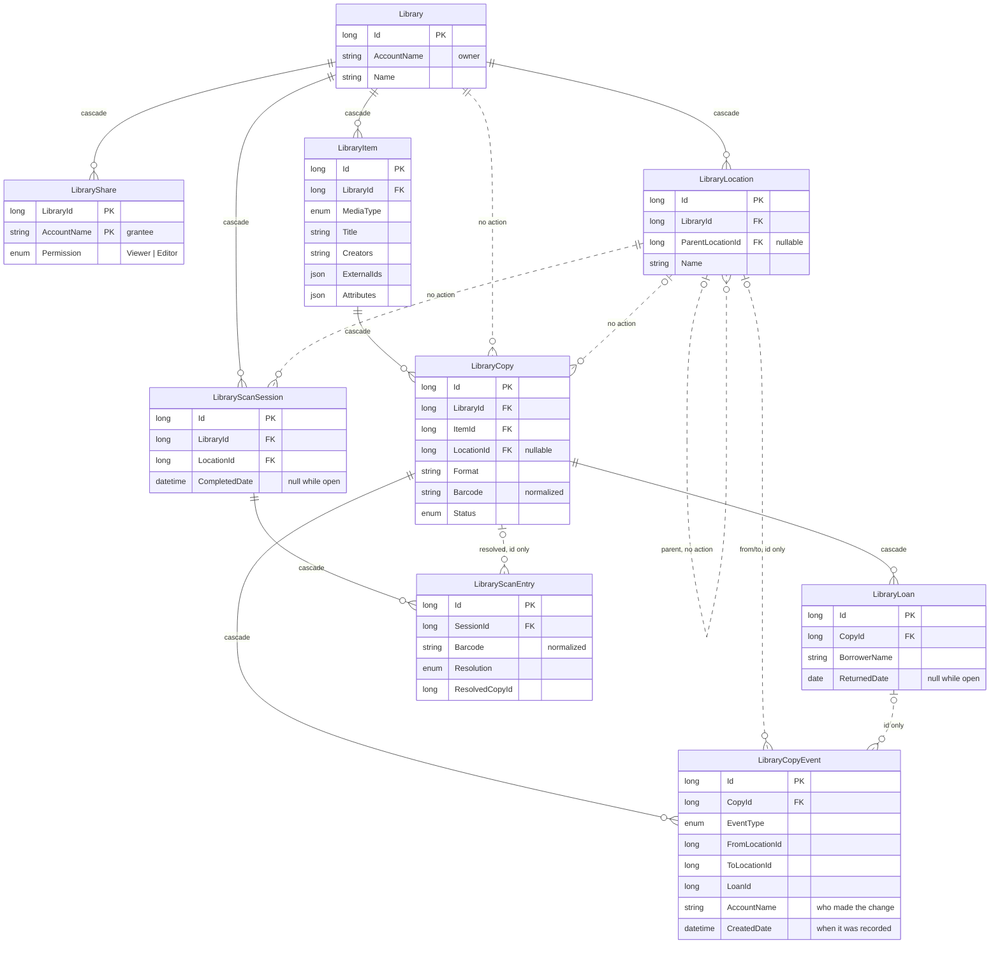
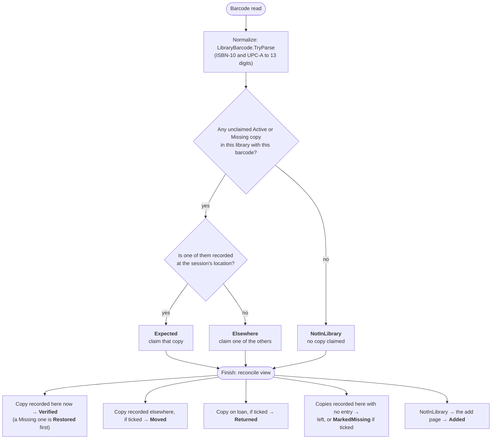

# Library

A personal inventory of physical media: books, movies and board games, plus anything else loanable.
For each copy it records where it lives, who borrowed it, and the history of both.
A library can be shared with other accounts as read-only or editable.
The phone is the main tool: finding things by title, author or series, adding them by title search, and scanning barcodes to confirm one location's inventory at a time.

This is deliberately not a full library system.
There are no holds, fines, patrons or cataloguing standards.
It started out closer to one, with ISBN lookup, edition details, tags and prices, and was cut back to roughly a spreadsheet of titles, series and authors with a notes column, plus copies, locations, loans and history.
The cut fields are listed under [Removed fields](#removed-fields).

**Status.** The data model, migration and API exist (`src/Contracts/Libraries/`, `NsContext` `#region Library`, `Migrations/*_AddLibrary*`), as do the Client, Tool and UI (`Pages/UI/Libraries/`), and so do three helpers the API is built on: barcode normalization (`Utilities/LibraryBarcode.cs`), the access check (`DataAccess/LibraryAccess.cs`) and event times (`Utilities/LibraryEventTimes.cs`).
External lookup and covers exist too (`Services/Libraries/`), and so does the camera scanner (`wwwroot/js/library-scanner.js`) and scan sessions with their reconcile view.
Export, described below, is the remaining work.

## Data model: item → copy

The Contracts classes are the EF entities, the same as Ledger.
There are two levels, and that split is what handles duplicates:

- **`LibraryItem`** is the work, e.g. *The Hobbit*.
  It holds the title, creators, series, summary, notes, cover and external ids.
  Notes are your own (a gift from whom, whose it is); the summary is the lookup's description.
  Notes on one physical copy, such as a signed one, go on the copy instead.
- **`LibraryCopy`** is one physical object.
  It holds format, barcode, acquired date, location, status and its own notes.
  Copies exist for owning the same thing twice, such as a board book and a paperback of one kids' book.

A hardcover and a paperback are one item with two copies.
Two identical paperbacks in different rooms are also one item with two copies.
A search result reads naturally from that: *The Hobbit — 2 copies: Hardcover (Office › Shelf 3), Paperback (Kids' room)*.

**Rejected: work → edition → copy.** That is the "correct" bibliographic model (roughly FRBR), and it avoids repeating edition details when you own two copies of the same edition.
It was rejected because owning two identical copies is rare, and a third level puts an extra screen or choice into every add and every scan.
Edition details were later dropped altogether (see [Removed fields](#removed-fields)); the format is the only thing about an edition a copy records.

**Recognizing an existing item.** Adding something that's already in the library doesn't automatically create a new item.
Picking a lookup result stores its id (an Open Library work, a TMDB movie or a BoardGameGeek game) in `LibraryItem.ExternalIds`.
If an item in the library already shares any external id with the pick, has a copy with the same barcode, or has exactly the same title (ignoring case), the add flow offers "add as another copy of *X*".
That is how a paperback joins the hardcover's item instead of creating a duplicate.
The keys in `LibraryExternalIds` are part of that match, so renaming one quietly stops it finding items saved under the old name.

**Media types.** `LibraryMediaType` is an enum stored as a string (`NVARCHAR(32)`, the same way as `AccountTier`), so adding a value needs no migration.
Fields that only apply to some types (page count, runtime, player count, play time) go in `LibraryItem.Attributes`, a string dictionary stored as a JSON column.
That avoids a column per type-specific field or a table per type.
`Format` on the copy is a free string with suggested values per media type, not an enum.
New formats show up (Steelbook, 4K + Blu-ray combo), and none of them change any behaviour.

**Creators** is a single semicolon-separated string, like `Account.Roles`, searched with `LIKE`.
A creators table would allow "everything by this author" with an exact match, but at personal-library volumes a `LIKE` on one column is just as good and much less code.

**Barcodes are stored normalized** on `LibraryCopy.Barcode` and `LibraryScanEntry.Barcode`, and every search normalizes its input the same way.
All of that goes through `LibraryBarcode.TryParse` (`Utilities/LibraryBarcode.cs`).
The same physical barcode reaches the server in several forms:
- A book scanned from its cover is an ISBN-13, but typed in from the copyright page it is often an ISBN-10.
- A movie's UPC-A comes back as 12 digits from one scanner and as a 13-digit EAN with a leading zero from another.

So every retail product code is brought to **GTIN-13**: ISBN-10 is converted to ISBN-13, and UPC-A gets the leading zero.
A path that skips this stores a form the others don't match, and lookups quietly miss.

- **Wrong check digit:** a code that has the length of an ISBN-10, UPC-A or EAN-13 but the wrong check digit is rejected (the API's 400), not stored.
  It is nearly always a typo or a misread, and a stored typo is a copy its real barcode never finds.
  The rare book with a misprinted ISBN can be added with no barcode.
- **8-digit codes are left as read.** UPC-E and EAN-8 are both 8 digits, and the digits alone don't say which was scanned.
  Expanding UPC-E to UPC-A would therefore mangle every EAN-8, and neither is common on books, movies or games.
- **Anything else** is kept, uppercased with spaces and dashes removed: a Code 128 or QR sticker you printed for a tool, say.
  This is what lets the "other loanable items" media type work with your own labels.

**A copy has one barcode**, whatever is printed on it, and a code matches a copy only by that (`LibraryBarcode.MatchesCopy`, used by item search, the add page's duplicate check, and scan resolution).
Keep finding copies through it, so how a code matches stays decided in one place.
A book printed with only a retail UPC, common on US mass-market paperbacks, keeps the UPC: it's what a rescan reads.
The copy used to carry the ISBN from the copyright page as a second code, because the ISBN was what books were looked up by; with ISBN lookup gone it had no use.

**History.** `LibraryCopyEvent` is append-only and written by the server whenever a copy's location, loan or status changes.
It also records which account made the change, because editors exist.
`CreatedDate` is when the event was recorded, and events are never edited after that.

**When a copy was acquired** comes from `LibraryCopy.AcquiredDate` (when set), not from its `Acquired` event's `CreatedDate`.
An initial inventory records a shelf of books bought over ten years all on the day it is scanned.
The real purchase dates often get filled in much later, by editing the copies.
Because the acquisition time is read from the copy, editing `AcquiredDate` moves the book's arrival in history and in the [gource export](#gource-export-planned) without touching the event log.

**Rejected: an `EffectiveDate` on the event**, copied from `AcquiredDate` when the copy is created.
It goes stale the moment the purchase date is corrected, and keeping it current would mean editing an append-only table to keep a second copy of a fact the copy already holds.
That is the drift this repo avoids elsewhere.

The same rule covers loans, which already carry their real dates: a `Loaned` event's time is its loan's `LoanedDate`, and a `Returned` event's is its `ReturnedDate`.
Recording a loan that started last March puts it in March.

One helper computes event times for both the item page's history and the export.
It walks a copy's events in recorded order (`CreatedDate`, then `Id`):

- `Acquired` takes the copy's `AcquiredDate`, `Loaned` its loan's `LoanedDate`, and `Returned` its loan's `ReturnedDate`, each at midnight UTC and flagged as date-only.
  When that date isn't set, or for any other event type, the event takes its `CreatedDate`.
- Each time is then clamped up to at least the previous event's time.

The date-only flag is for display: a midnight-UTC time converted to local time shows as the previous day anywhere west of UTC, so the item page shows a date-only event as a date.
An event the clamp moves stops being date-only, since its time then comes from another event.

The clamp keeps a copy's events in recorded order whatever dates are entered.
A copy never moves or gets lent before it arrives, and a loan backdated past a move that was recorded before it lands at the move instead of before it.
The [gource export](#gource-export-planned) depends on that order.

Loans have their own table (`LibraryLoan`), since they carry their own fields (due date, borrower).
The event log references a loan rather than duplicating it.
A copy has at most one open loan, which the database enforces with a filtered unique index, `IX_LibraryLoans_CopyId_Open` on `CopyId` where `ReturnedDate IS NULL`.
The loan action checks first, but two requests close together, such as a double tap on Lend, can both pass that check.
A second open loan would then break return, which expects exactly one, until it was fixed by hand.
With the index, the second insert fails and the action returns 409.

The ordinary `CopyId` index is declared explicitly beside it.
Left implicit, EF adopts the filtered index as the foreign key's index and drops the unfiltered one, leaving a copy's returned loans with no index.

**Loanees** are a free-text `BorrowerName`, optionally linked to an account via `BorrowerAccountName`.
Most borrowers are friends without accounts.
The link exists so a borrower with an account could later see what they have out.

### Removed fields

Dropped by the `TrimLibraryFields` migration, after the library was reset, so no data was carried over:

- **`LibraryItem.Tags`.** Never used, and the tag badges linked to a search that didn't search tags.
  Notes cover it.
- **`LibraryCopy.Isbn`**, the second code for a book with a UPC barcode, along with its numeric-keypad field and `LibraryBarcode.TryParseIsbn`.
  See above.
- **`LibraryCopy.Publisher` and `PublishedYear`.**
  Filled from the ISBN lookup's edition, and nobody would type them.
- **`LibraryCopy.Condition`, `AcquiredFrom` and `PricePaid`.**
  A list of what we own doesn't need them; anything worth remembering goes in the copy's notes.

### Delete behaviour

In the diagram, solid lines cascade on delete.
Dashed lines labelled `no action` are foreign keys that block the delete.
Dashed lines labelled `id only` are plain columns with no foreign key.

SQL Server refuses to create a schema where a table can be reached by two cascade paths.
`LibraryCopy` has both `LibraryId` and `ItemId`, and `LibraryItem` cascades from `Library`, so `Library → Copy` directly would be a second path.
The cascades are therefore:

- `Library → Item → Copy → Loan / Event`
- `Library → Location`, `Library → Share`, `Library → ScanSession → ScanEntry`

Every other foreign key into a copy or location (`Copy.LibraryId`, `Copy.LocationId`, `Location.ParentLocationId`, `ScanSession.LocationId`) is `NoAction`.

Deleting a library therefore doesn't rely on one cascading delete of the library row.
That would only work if SQL Server checks the `NO ACTION` keys after the statement's cascades have run, which is plausible but has never been tested here.
The delete runs three bulk deletes in one transaction instead:
1. copies, which takes their loans and events with them;
2. scan sessions, which hold `NO ACTION` keys to locations;
3. the library, which cascades to items, locations and shares.
   Its locations' parent keys point only at other locations deleted in the same statement.

Deleting a location returns 409 while copies or child locations are still in it, so nothing silently loses its location.
Scan sessions at that location are deleted with it.
They are a tool for reconciling a location, not history of the copies, and keeping them would make any location that was ever scanned impossible to delete.

The location and loan ids on `LibraryCopyEvent` and the copy id on `LibraryScanEntry` are plain columns, not foreign keys, so history survives the rows it mentions being deleted.
The UI shows a deleted location as "(deleted location)" instead of hiding the event.

### Naming

The namespace is `TcpWtf.NumberSequence.Contracts.Libraries`, not `.Library`, because the root entity is called `Library`.
A type with the same name as its namespace causes CS0118 in any file whose enclosing namespace makes `Library` resolve to the namespace first.
The Razor Pages folder has the same problem (`Pages/UI/Library` would make `number_sequence.Pages.UI.Library` a namespace), so it should be `Pages/UI/Libraries`, with routes still under `/ui/library`.

## Access and sharing

- `AccountRoles.Library` gates the whole feature.
  Everyone who uses a library needs it, including people it is shared with.
  `Account.Roles` was widened from 64 to 256 characters in the same migration, since adding `Library` brings the current set to 35.
- `LibraryShare(LibraryId, AccountName, Permission)` grants `Viewer` or `Editor`.
  `Owner` is never stored on a share: the owner is `Library.AccountName`.
  `LibraryPermission` is ordered (`Viewer < Editor < Owner`) so a check is a single comparison.
  - **Owner:** everything, plus managing shares and renaming or deleting the library.
  - **Editor:** add and change items, copies, locations, loans and scans.
  - **Viewer:** read only.
- `Library.CallerPermission` is `[NotMapped]`.
  The API fills it per request so the UI knows which controls to show.
- **Every library-scoped API action goes through `DataAccess/LibraryAccess.cs`.**
  `GetLibraryWithAccessAsync(libraryId, accountName, minimum)` loads the library with `CallerPermission` set.
  `GetAccessibleLibrariesAsync` lists every library an account can reach.
  Nothing filters on `AccountName == User.Identity.Name` directly.
  That is the Ledger pattern, and copied here it would quietly lock out everyone a library is shared with.
  Ownership is compared in SQL rather than C#, so it uses the same case-insensitive collation as the account key.
- **No access is 404, too little access is 403.**
  An account with no access gets `NotFoundException`, so a library id doesn't reveal that the library exists.
  An account that can see the library but tries something above its level (a viewer editing) gets `ForbiddenException`, newly mapped to 403 in `ExceptionToStatusCodeMiddleware`.
  "Not found" would be wrong for a library that caller is looking at.
- The owner shares by account name, and the server checks the account exists.
  There is no invite flow.
- Tier limits: `TierLimits.LibrariesPerAccount` counts owned libraries only.
  `LibraryCopiesPerLibrary` uses the owner's tier (3,000 copies on Small).

## API

`LibraryController` (a partial class, one file per sub-resource like Ledger) is at `/library`, with `RequiresToken(AccountRoles.Library)`.
Everything is nested under `libraries/{libraryId}` except the lookup routes, which belong to no library:

- `lookup/search?mediaType=&q=`, `lookup/{source}/{sourceId}` and `lookup/cover?url=` call outside services and save nothing.
  See [External lookup](#external-lookup).

**Item order** (`items?sort=`, `LibrarySort`) is shelf order unless asked otherwise: the first creator's last name, then the series (or the title, for a book outside one), then the number in the series (unnumbered ones after, by year), then the title, with a leading "The", "A" or "An" ignored throughout.
Grouping by series *or* title keeps a series together while filing it among the author's other books, so the Dark Tower sits under D between *Cujo* and *Firestarter*, as on a shelf.
`Title` (article-free) and `Added` (newest first) are the other two.
Added counts a copy's date too, so a new copy of an item already here comes up with what a scan just brought in.
- **Location isn't a sort.** It belongs to copies, and an item with a hardcover in one room and a paperback in another has no one place.
  Filtering to a location gives the order of that shelf instead.
- **The last name is worked out, not stored.** `Creators` is one free-text field, so the key is the first creator's last word, with a trailing Jr., Sr. or roman numeral dropped and a particle (le, van, de…) kept with it: *Le Guin* files under L, as a library would.
  A name already written "Last, First" is taken as it is.
  A rare name will still file wrong; a "sort as" field waits for a real one.
- **Sorted in memory, not sql.** Sql can't do the last name or the articles, and a stored sort key would go stale the first time a path that writes items forgot it.
  Every match's sort fields (a few short columns) are read and sorted, and then the page is fetched by id.
  A library is at most a few thousand items, so that's cheap.
  Added is a plain date, so sql sorts it.

**Copies change location, status and loans only through dedicated actions** (`copies/{id}/move`, `/status`, `/loan`, `/return`), because each one writes a `LibraryCopyEvent`.
The general PUT of a copy leaves all three alone.
It does allow changing `ItemId` to another item in the same library: that is how a copy added as its own item gets merged into the right one.

**Rules the actions enforce:**
- **Not recorded:** a move to where the copy already is, or a status it already has.
- **Disposed copies** can't be moved or lent; restore one first.
- **Copies on loan** can't be marked missing or disposed, because the borrower has them.
- **Dates:** a loan's due date can't precede its loan date, and a return date can't precede the loan date.
  Both dates default to today (UTC).
- **Copy limit:** `LibraryCopiesPerLibrary` uses the **owner's** tier, since an editor adds to someone else's library.
- **Leaving a library:** anyone can delete their own share, so a library can be left without the owner.
  Only the owner can delete anyone else's.
- **Account names** for shares and borrowers are checked to exist, and lowercased, because accounts are stored lowercase.

**A loan's id is drawn from its sequence before the insert.**
The `Loaned` event's `LoanId` is a plain column with no foreign key, so EF can't fill it in.
Drawing the id first keeps the loan and its event in one save, which is atomic without an explicit transaction.
Explicit transactions are awkward here: the connection has retry-on-failure enabled, which requires running them through the execution strategy.
The only ones in the controller wrap bulk deletes (`InBulkTransactionAsync`).
Those bypass the change tracker, so a retry reruns them from the same state.

The draw is `Database.SqlQuery<long>(...)` read with `ToListAsync` and nothing composed on top.
Composing anything, even `SingleAsync`, makes EF wrap the sql as `SELECT TOP(n) ... FROM (...) AS s`.
Sql server refuses `NEXT VALUE FOR` inside a derived table and in any statement with `TOP`, so the composed form translates fine (`ToQueryString` shows nothing wrong) and fails only when it runs.

Two alternatives were rejected:
- **A real foreign key from event to loan,** so EF could fix up the id itself.
  It would add a second cascade path from copy to event (copy → loan → event beside copy → event), which sql server forbids.
  Making that key no-action would put copy deletes back on the untested question of when no-action keys get checked.
- **`UseHiLo`,** which has EF draw ids client-side on `AddAsync`.
  It needs a model change and a migration that drops the column default, and it doesn't fit the way every other table here gets its id.

**Search** (`items?q=&mediaType=&locationId=&loanedOut=`):
- **Text:** `q` is matched with `LIKE` against title, subtitle, creators, series and the item's notes.
  Notes are searched because they're where anything without its own field ends up, so searching them is the spreadsheet's Ctrl-F.
  The summary isn't, since a lookup's blurb matches far too much.
- **Barcodes:** if `q` parses as a barcode, a copy with that barcode also matches, so a scanned code can go in the same search box.
- **Locations:** `locationId` includes everything inside that location, so "Office" finds its shelves.
- **External ids:** `externalIdKey` with `externalIdValue` keeps items whose `ExternalIds` has that entry.
  The column is json, which EF sees only through the dictionary converter, so this one filter is sql (`JSON_VALUE`).
  The key becomes a json path, so it is limited to letters and digits.
- **Columns:** each item comes without its summary, external ids and attributes, which are null in the results even when set.
  Notes do come back, so `item list --raw` carries them.
  Those three are the large columns, and a page can hold 500 items.
  Copies come back whole, and each copy's `Loans` holds only its open loan.
  `items/{id}` has everything, including each copy's history with `OccurredDate` filled in by `LibraryEventTimes`.

**Responses are whole rows unless documented otherwise.**
Narrow projections are fine inside the server, where the code reading them knows what was selected.
An entity returned from the API with fields left out looks exactly like one whose fields are empty: a client can't tell a copy with no barcode from a copy whose barcode wasn't selected, and each new column has to be remembered in every projection or it silently comes back null.
So the API returns whole entities, loaded with `Include`.
Item search is the one exception, because its savings are real.
Its doc comment and the bullet above say which fields are missing.
The first version of this controller hand-mapped partial entities in several places, including loans; that was reverted for these reasons.

`Path` on `LibraryLocation` and `OccurredDate` on `LibraryCopyEvent` are `[NotMapped]` and computed per response, the same way as `CallerPermission`.
Clients resolve a copy's `LocationId` through the locations list, which carries the paths; responses don't repeat location rows on every copy.

**Errors.** The access helper and barcode normalization report errors by throwing (`NotFoundException`, `ForbiddenException`, `BadRequestException`), and `ExceptionToStatusCodeMiddleware` maps those to status codes.
The Library feature is the first code to throw them.
Before, that middleware treated every exception as a crash: it logged each at Error and returned the full stack trace as the body, which the UI would have shown on every 404.
It now returns just the message for the mapped exceptions and logs them at Information.
Unmapped exceptions are still 500s with the full trace.

## Client and Tool

The Client is `LibraryOperations` (partial, one file per sub-resource) exposed as `NsTcpWtfClient.Library`, one method per API route.
Deletes return nothing, because the API answers them with 204.

The Tool is `ns library` (alias `lib`).
Libraries themselves are managed at the top level (`lib ls`, `lib create`), with `share`, `location`, `item`, `copy` and `loan` beneath it.
Each takes the usual CRUD aliases.
Choices that aren't obvious from `--help`:

- **`--library`/`-L` can be left out** when the caller can access exactly one library, which is the common case.
  With more than one, the command lists them and asks for the flag.
  Making every command take a library id argument would have meant typing the same number on every line.
- **Prompts take a blank answer as "keep the current value" and a lone `-` as "clear it".**
  The shared `Input` helpers can't leave a value empty or clear one that's set, and most library fields are optional.
  So the library commands carry their own small prompts (`LibraryCommand.Common.cs`) rather than changing the shared ones under every other command.
- **`item create` offers to add copies straight away**, since an item with no copies is rarely what was meant.
- **Location, status and loans have their own commands** (`copy move`, `copy status`, `copy loan`, `copy return`), matching the API, and `copy update` doesn't prompt for them.
  `copy update` does prompt for `ItemId`, which is how a duplicate gets merged.
- **`item read` shows the item, a table of copies and one combined history**, with event dates from the server's event-time helper.
  Moves show location paths and loans show the borrower.
  `--raw` gives the json instead.
- **`item list --sort`** takes the api's [item order](#api): `Shelf` (the default), `Title` or `Added`.
- **`series set <name> <id[=n]>...`** or **`series set <name> --query <q>`** is the [bulk series fix](#external-lookup).
  With ids, a bare `id` keeps its number and `id=n` sets it.
  With `--query` it lists the matches in likely series order and asks for each one's number (blank keeps it, `-` for none, `x` leaves the item out), then confirms.
  A name of `-` takes the items out of any series.
  `series list` gives the names in use.
- **Deleting a library, item or copy asks for confirmation** and points at disposing instead, which keeps history.
  Deleting a location doesn't ask, since the server refuses unless it's empty.

`lookup <title>` (`--type` for what to search, `--source` to get one record by id) writes the same columns whatever was asked.
`export <libraryId> [file]` waits for an export endpoint.
The UI is the main way to manage a library, and the Tool is for scripting: piping the export into gource, or diffing it against a spreadsheet.
So `export` and `lookup` write plain output with stable columns, to stdout unless a file is given, and print no prompts or other chatter.

## UI

Razor Pages under `Pages/UI/Libraries/`, routed at `/ui/library`, and built for a phone first: lists of cards rather than tables, and copy actions as small forms that fold open in place.
They call the API through `NsTcpWtfClient` like Ledger, so the access rules are the API's and the pages only hide controls by `Library.CallerPermission`.
The nav link and home card show for the `Library` role.

- **Every action posts, then redirects back** with the outcome in a `[TempData]` message, so reload and the back button never resubmit.
  A form shown again in the same request, with what was typed, uses `FormError` instead: a `[TempData]` property set without a redirect is still saved, and the message shows a second time on the next page.
- **The home search covers every library you can see**, because "do we have this?" shouldn't start by picking a library.
  It runs the item search once per library rather than adding a cross-library search endpoint, since an account sees a handful of libraries at most.
  Searching is by title, author or series.
  A barcode still finds the copy that carries it, which is how the book in hand is pulled up to lend.
  A barcode with no match says to try the title, since another edition or a copy added without its barcode won't match, and offers "Add to *library*" with the barcode filled in.
- **Rejected: a "do I own this?" check by barcode.**
  A cross-library `barcodes/{barcode}` endpoint and the Tool's `owned` command answered it for a code scanned in a shop.
  They were removed: a different edition of the same book has a different barcode, so "not owned" didn't mean not owned.
  A title search, on the site or `ns lib item list -q`, is the reliable answer.
- **Series** (from a library's page, for editors) is the [bulk series fix](#external-lookup): search, tick, name the series once, a number per book.
  With no search it lists the library's series, each a link that searches for it, which is the way to fix one's spelling everywhere.
- **A library's page sorts** by shelf order, title or recently added ([item order](#api)).
  Shelf order leaves the url plain, so a bookmark of the library is its shelf.
- **Adding is title first.** The add page starts with a title search, then the item form, filled in from the pick or by hand, then the copy, whose barcode is optional and last.
  Scanning before the title was the old order, built around looking books up by ISBN; once that went (see [External lookup](#external-lookup)) a barcode had nothing to fill in, and putting it first only meant a code to carry around while the title was searched for.
- **Adding an item adds its first copy in the same form.**
  Before creating, the page looks for an item this might already be: one with a copy carrying the same barcode, or one with exactly the same title.
  If it finds one, it offers "Add copy here" on each match, which keeps everything typed for the copy, or "Create a new item anyway".
  The barcode is checked with `LibraryBarcode.TryParse` before anything is created, so a typo doesn't leave behind an item without its copy.
  "Add another after this" returns to the form with the type and location kept, for entering a shelf at a time.
- **Merging a duplicate** is "Belongs to another item?" on the copy's edit page: find the other item, and move the copy to it.
  That changes `LibraryCopy.ItemId`, and the copy's history goes with it.
  The item left with no copies is then deleted from its own page.
- **Edit pages apply the form onto the item or copy fetched from the server, then send that.**
  An update replaces every editable field, and the item form doesn't carry `ExternalIds` or `Attributes`.
  Sending the bound form would wipe them.
- **The acquired date starts blank, with a Today button.**
  Defaulting it to today would put every book in a first inventory into history as bought this week.
- **Confirmations read their text from `data-confirm`.**
  An inline `confirm('…')` breaks on a title with an apostrophe, because the attribute is decoded before the script runs.
- **Deleting a copy is only on its edit page**, so a misplaced tap on the item page can't do it.
  Status changes and "Disposed" are on the item page.

- **Lookup is all GET on the add page.** A title lists candidates, and picking one comes back with `source` and `sourceId`.
  The lookup box takes titles only.
  A code passed as `barcode` (from a search that found nothing, or a scan's reconcile view) goes on the copy and isn't looked up.
  Each step carries the barcode, location and "add another" along, so that code still lands on the copy after the title search.
  The lookup's external ids, attributes and cover urls aren't form fields, so they ride along as hidden inputs.
  The duplicate check runs as soon as the form is filled in, not only on submit, so "this might already be here" shows before anything is typed.
- **Adding a looked-up copy to an item typed in by hand** gives that item the lookup's external ids it lacks, so the next edition finds it by id rather than by title.
  Ids it already has are never changed.
- **Covers** show on cards (thumbnail) and the item page.
  They come only from lookups: the pick when an item is created, or "Find a cover" on the item's edit page.
  That is a title search, starting from the item's title, listing only results with a cover; picking one sets the cover and nothing else, so details corrected by hand stay corrected.
  The pick posts the result's source and id, and the page fetches the record again for its cover urls rather than taking urls from the form.
  The edit page can also remove a cover.
  The `` tags point at the api route directly, which the token cookie authenticates, with the item's modified date in the query so the api can cache covers for a month.
  The api streams each cover from blob storage to the response rather than reading it into memory first, since a page of cards asks for dozens at once.
- **Credits:** pages showing looked-up data name the source (`_LookupAttribution`), as TMDB's terms require.

**Scan buttons** sit next to the search boxes on the library home and a library's page, and next to the copy form's Barcode field (on the add page, adding a copy, and editing one).
In a search box a read puts the code in the box and submits it, so a scan does exactly what typing the code does.
A code a library's page doesn't find offers "Add it", which opens the add page with the code.
In the copy form the read only fills the field (`data-library-scan-fill`), since submitting would save a half-filled form.
Editing a copy is how one added without a barcode gets it later.

The add page's lookup box has no Scan button.
It takes titles, and a barcode has nothing to look up.

**Books with a UPC** keep the UPC as their barcode, since that's what a rescan reads.

## Gource export (planned)

[Gource](https://gource.io) animates a version-control history as a growing tree.
Its [custom log format](https://github.com/acaudwell/Gource/wiki/Custom-Log-Format) is one line per change, `timestamp|user|A/M/D|path|colour`, which makes it an easy way to watch a library fill up and move around over the years.
The export is `GET library/libraries/{id}/events/gource` (text/plain), with `library export-gource <libraryId> <file.log>` in the Tool, then `gource file.log`.

Mapping:

- **Path:** `/{location path}/{title} ({format}) #{copyId}`, so locations are the directories and each copy is a file.
  The copy id keeps two identical paperbacks from collapsing into one file.
  `|` and `/` in names are replaced, since they are the format's field and path separators.
  A copy with no location sits under `/(no location)/`, a loaned copy under `/(on loan)/{borrower}/`, and a missing copy under `/(missing)/`.
- **Colour:** one per `MediaType`, rather than gource's default of colouring by file extension, which here would mean nothing.
- **User:** the event's `AccountName`, so an editor's activity shows up as a second person working on the tree.
- **Events:** `Acquired` and `Restored` → `A`.
  `Verified` → `M` (a pulse on the file).
  `Disposed` → `D`.
  Gource has no rename, so `Moved`, `Loaned`, `Returned` and `MarkedMissing` each become a `D` at the old path followed by an `A` at the new one, both with the same timestamp.
- **Time:** the event time from the shared helper (see [History](#data-model-item--copy)) as unix seconds, sorted ascending with `Id` to break ties, because gource requires the log to be in order.
  The sort must be stable: clamping can give several of a copy's events the same time, and they still have to come out in recorded order.

Because the helper's clamp keeps each copy's events in recorded order, the `D` half of each move can use the event's stored `FromLocationId`, and it names a file gource has already seen.
A `D` for a path gource has never seen leaves an orphaned file in the tree.
That is why the clamp exists, and why a date on a copy or loan can never reorder that copy's events.

Paths use location names as they are now, since locations don't keep a name history.
A renamed shelf shows under its new name for its whole history.
A deleted location shows as `(deleted location #id)`.

## External lookup

`Services/Libraries/`.
`LibraryLookup` picks the provider for a request and caches answers; one class per provider does the calls.
Every lookup is a title search: a search returns candidates that may lack fields (TMDB's search has no director), and the chosen one is fetched again by `Source` and `SourceId` for the full record, a `LibraryLookupResult` of item fields, a format for the first copy, external ids, attributes and cover urls.
It saves nothing, and nothing is looked up by barcode.

- **Books:** Open Library's search, then the chosen work.
  - A work's details are spread over the work (title, summary, first publication, covers) and the search index, which already has the author names resolved.
    Using the index saves a request per author.
    Its record is only used when its work id matches, because a search that misread the query would return another book's authors without anyone noticing.
    When it doesn't match, each author's record is fetched instead.
  - **The title is the work's**, as Open Library has it.
    A work groups every edition under whatever title its first cataloguer typed, sometimes with the series written in ("The Great Hunt (The Wheel of Time Book 2)") or in another language.
    It's corrected on the add form.
  - **No series is filled in.** See below.
  - `Year` is the search index's `first_publish_year`, which is the earliest year of any edition in the work, so one misdated or misfiled edition drags it early (*Song of Susannah* as 1999, not 2004).
- **Movies:** TMDB `search/multi` (movies and TV in one request), then `movie/{id}?append_to_response=credits` or `tv/{id}`.
  A movie's TMDB collection becomes its series.
- **Board games:** BoardGameGeek XML API2.
  Its search returns every game with a matching name, in no useful order, with names and years only; "Catan" matches hundreds.
  So names are ranked (exact, prefix, shortest), the best 20 are fetched in one `thing` request (BGG's limit), and those are ordered by how many people rated them, which puts the game most people mean first.
  An expansion's base game becomes its series.

**Series** come from TMDB collections and BoardGameGeek base games, whose data is clean, and are otherwise typed by hand.
Sources spell one series differently ("Wheel of Time", "The Wheel of Time"), so when a lookup fills a series in, `LibrarySeries.MatchExisting` swaps in the spelling the library already uses, comparing letters and digits without a leading "the".
Not at save time: then respelling one item to fix a series would be undone by the others still spelled the old way.
The series box also suggests the library's names (`GET libraries/{id}/series`).

**Fixing a series by hand is per series, not per book:** `PUT libraries/{id}/series` sets one name on many items, each with its own number, and the Series page and `series set` are built on it.
- **The name is used as given**, not matched to an existing spelling, because correcting a spelling is often the point.
  Search for the old spelling, tick everything, type the new one.
- **A number is sent for every item**, and null means none, so a client keeps a number by sending it back.
  The page prefills each box with the saved number; the Tool's bare `id` fetches it.
  A blank name clears numbers too, since a number without a series means nothing.
- **All or nothing:** an id not in the library refuses the whole request, so a typo doesn't leave half a series set.
- **The list is in likely series order** (saved number, then year, then title), not shelf order, and "Number ticked 1, 2, 3…" numbers the ticked rows in that order.
  For a series with no numbers saved, year is usually publication order, so that's most of the numbering done; a missing year sorts last and needs its number typed.

**Rejected:**
- **Looking books up by ISBN** (Open Library's edition, then Google Books when it had no record).
  It was the original plan, since a scan is quicker than typing, and it was built and then removed after two shelves.
  The data was the problem, not the parsing:
  - Edition titles, work titles and series were each wrong in a different way per shelf.
    Works titled in Portuguese for an English book, series written into titles in a dozen forms, series fields present on three of nine editions of one series, a book's edition filed under a duplicate work, a whole reissue Open Library mostly didn't know.
  - Each shelf needed new parsing rules (`LibrarySeries` grew to parse series fields, bracketed series in titles, "Book Two of …" subtitles, titles that were only a series label) and a refresh to re-apply them to saved items.
  - A title search where you pick the right work and correct it costs one step more than a scan and leaves nothing to clean up later.
    The barcode is still scanned, for the copy.
- **Google Books**, as the fallback for an ISBN Open Library doesn't know.
  It was first used without a key, on "allowed at low volume", but the shared keyless quota is zero: every keyless request is a 429 (`quota_limit_value: 0`).
  With a key it answered, but only knows the edition (no first-release year), has no series, and was mostly needed to fill in Open Library stubs.
  It went with ISBN lookup.
- **UPC databases** (e.g. UPCitemdb's free tier).
  Their results for movies and games are thin and inconsistent, and the free tiers are rate limited to around 100 a day, which a first inventory run blows through.
- **Hardcover**, which has structured series.
  It's the one to try if series by hand turns out to be too much work.
- **An `ILibraryLookupProvider` interface.** The providers don't share much of a shape, so the interface would have been mostly unsupported methods.

**Caching:** answers are cached in `IMemoryCache` for an hour, misses included, since one add asks about the same record several times (search, pick, the form shown again).
Failures aren't cached.

**Failures** become `FailedDependencyException`, which the middleware maps to **424**, with a message naming the provider.
Not a 5xx: the client retries those five times over about half a minute, which would turn one slow provider into a page that hangs.
The add page shows the message and carries on with typing details in.

**Provider values aren't trusted in urls.** Only the cover client has a host allowlist, so anything taken from a response is checked before it goes into a request or a link.
Open Library's keys carry their leading slash (`/works/OL45883W`) and are appended straight after the host, where a key like `@other.host/x` would send the request to another host.
So each key must match its kind's shape (`/works/OL…W`, `/authors/OL…A`) or is ignored.
BoardGameGeek's ids must be digits, since they go into a query unescaped.
A source link that isn't http or https is dropped, because the add page puts it in an `href`.

**Tokens:** `Options.LibraryLookup` (`TmdbToken`, `BggToken`).
A blank token turns that provider off; searching that media type is a 400 saying so.
They come from Key Vault (`library-lookup-tmdb-token`, `library-lookup-bgg-token`) through the `tompostler` variable group into `deploy-code.yml` and `AppServiceSettings.json`, and through `devinit.ps1`, which leaves a missing one unset rather than failing.
Azure Pipelines passes `$(name)` through literally when the group has no such secret, so a token starting `$(` also counts as unset.
That lets the app deploy before a token is registered.

A token goes in a header, never a query parameter, because `LibraryLookupHttp` logs every request url.

**Credits:** TMDB's terms require the line "This product uses the TMDB API but is not endorsed or certified by TMDB" on pages showing its data, and BoardGameGeek asks for credit too.
`_LookupAttribution` shows a line per source, on the add page and on the item page, judged by the item's external ids.
TMDB also asks for its logo; there is no `wwwroot` to serve one from, so for now it's the text line only.

### Covers

Stored in blob storage (container `library`: `covers/{itemId}.webp` and `covers/thumbnails/{itemId}.webp`), not as SQL bytes like the Ledger logos, because a few thousand covers don't belong in the database.
They are never hotlinked: provider URLs change, and hotlinking leaks browsing to third parties.
The extension is only so a cover downloaded by hand from the storage account opens; the app serves the content type from `LibraryCovers`.
It does tie the path to the format, so changing the format means renaming or re-encoding the existing covers along with it.

- **Every cover is re-encoded** by `LibraryCovers` with SkiaSharp (already in the app for ScottPlot): turned upright from its EXIF orientation, scaled to fit 900px and 240px, and saved as WebP on white.
  That keeps lists light (a 240px thumbnail is a few KB) and makes serving them safe: what's stored is an image this code drew, so nothing fetched is ever served from this site as-is.
  That includes the add page's preview of a lookup cover (`lookup/cover`), which is re-encoded the same way.
- **WebP at quality 90.** WebP is a quarter to a third smaller than JPEG at the same quality, and every current browser shows it.
  PNG was rejected: covers are photos and artwork, which lossless compression makes several times larger for no visible gain.
  Quality is 90 rather than the usual 75–80 so a stored cover is still a good source if covers are ever re-encoded (a new size, say) without going back to the providers.
  The flattening onto white is deliberate even though WebP keeps transparency: a transparent cover with dark artwork disappears against the dark theme.
- **Fetching is only from provider hosts**, checked again on every redirect, because the urls come from the request.
  The cover HttpClient follows no redirects itself; `LibraryCovers` follows up to three, checking each host.
  Open Library's cover urls redirect to archive.org, which is why it's on the list.
  Without the check, the cover endpoint would fetch any url for anyone with the Library role, including addresses inside the app service.
- **Rejected: uploading a cover**, such as a phone photo of the book.
  It was built and removed: a cover is a nicety, the lookup's is good enough for the books, movies and games that have one, and the upload was a second way in for untrusted bytes.
  An item added by hand, or whose cover was wrong, gets one from "Find a cover" on its edit page.
  `LibraryCover` now carries only `SourceUrls`.
- **Limits:** 15 MB in and 50 megapixels, since a small file can claim enormous dimensions and decoding allocates for all of them.
- **Deletes:** deleting an item or a library deletes its cover blobs after the rows are gone, so a failure leaves an unreferenced blob (logged) rather than an item pointing at a missing cover.
- **The container** is in `storageAccountContainerNames` in `build/jobs/deploy-prereqs.yml` for both prod and LocalDev.
  The app doesn't create it, so the prereqs pipeline has to run before covers work in either.
- **LocalDev mirrors prod's covers** when `devinit.ps1` replaces `nslocal` from prod: it copies prod's `library` container into the local one server side.
  A database copy alone leaves every prod item with `HasCover` set and no blob, so every cover is a broken image locally.
  Every blob is overwritten rather than skipped when it exists: a replaced cover keeps its name, and once the copies diverge, a local-only item can get the same id as a later prod one, so skipping by name (or by newer timestamp, as azcopy's sync does) can keep the wrong image.
  Local-only blobs are left in place, since nothing shows a cover its item isn't flagged for.
  The `pdf` container isn't copied: those are patient documents, and nothing local needs them.

## Camera scanning

`wwwroot/js/library-scanner.js` opens a full-screen camera view from any `data-library-scan` button, reads one barcode (EAN-13, UPC-A or UPC-E), beeps and vibrates, and hands the code to the page's own text box.
The text box is always there: buttons stay hidden without a camera api (plain http other than localhost), and a USB or Bluetooth handheld scanner types into the box like a keyboard.

- **The browser's `BarcodeDetector` when it has one** with those formats (Android Chrome, macOS), else the `barcode-detector` ponyfill, which runs zxing-cpp compiled to WebAssembly. iOS Safari has no `BarcodeDetector` at all, which rules out the native api alone.
  The ponyfill (44 KB) and its `.wasm` (925 KB) are only downloaded on the first Scan tap where there's no native detector, never on page load.
- **Vendored, not from jsDelivr**, for the reasons in [static-assets.md](static-assets.md).
  The ponyfill fetches its `.wasm` from jsDelivr unless told otherwise, so the script overrides `locateFile` with our url.
  That url comes from `StaticAssetUrls`, which resolves it through the static-asset manifest to the fingerprinted, immutable route; the tag helpers can't do it, since no tag references the file.
- **One read, then close.** A barcode's check digit is validated by both detectors, and the server parses every code through `LibraryBarcode` anyway, so a second confirming read isn't worth the delay.
  Continuous scanning with a debounce belongs to scan sessions.
- **The camera closes when the page is hidden.**
  A locked phone suspends the stream and it doesn't reliably resume.
- **Audio** is unlocked by the tap that opens the scanner, since iOS only plays sound from a context created in a user gesture.
- **Searching scans quietly** (`data-library-scan-quiet`, on the home and library pages): vibration, no beep.
  It was built for checking "do I own this?" in a shop, where a success beep is noise, and stays because it does no harm.
  Adding and scan sessions beep, since they're done often without looking at the screen.

## Scanning and reconciling

The same flow handles first-time inventory and later reconciling.
It lives in `LibraryController.Scans.cs`, the pages under `Pages/UI/Libraries/Scans/`, `wwwroot/js/library-scan-session.js`, and `library scan` in the Tool.

1. Pick a location (the library page's "Scan a shelf", or a location's Scan link).
   This starts a `LibraryScanSession`.
2. Scan continuously.
   Each code becomes a `LibraryScanEntry`, stored on the server as it is scanned, so a phone that locks or reloads mid-shelf loses nothing.
   Keeping the state in browser memory was rejected for exactly that reason.
3. Each entry is matched when scanned: `Expected` (a copy with this barcode is recorded here), `Elsewhere` (recorded at another location or none), or `NotInLibrary`.
4. **Finish** shows the reconcile view:
   - here: verified on apply;
   - recorded somewhere else: ticked to move here, by default;
   - recorded here but not scanned: left as is unless ticked to mark missing (a copy on loan is listed but can't be);
   - new codes: each is added through the add page, which comes back here.
5. Applying writes the events and sets `CompletedDate`, in one save.

For a first inventory nothing is expected anywhere yet, so every entry is `NotInLibrary`.
Adding a shelf by title on the add page, scanning each barcode onto its copy, is quicker than a scan followed by an add per code.

**Duplicates while scanning.** Each scan matches at most one copy, and an earlier scan in the same session claims its copy first.
"Unclaimed" means not already the `ResolvedCopyId` of an earlier entry in the session.
When several copies share the barcode, a copy recorded at this location is claimed before one recorded elsewhere, so scanning a shelf never reports a move for a copy that was already there.
Two copies of the same paperback therefore need two scans.
A third scan of that barcode resolves to `NotInLibrary`, which is correct: it's a copy you didn't know you had.
An accidental double scan is fixed by removing the entry, after which every remaining entry is matched again in scan order, since the removed one may have claimed the copy a later scan missed.
Matching is one function (`Resolve`) over candidates loaded through `LibraryBarcode.MatchesCopy`, so scanning and re-matching can't disagree.

Entries are posted one at a time, in order, because each match depends on which copies earlier scans claimed.
Two devices scanning the same session at once could both claim one copy; one person scans a shelf, so that isn't guarded.

`Missing` copies are matched along with `Active` ones, because scanning a missing copy is how it gets found.
`Disposed` copies are not matched.
A disposed copy that turns up again is restored deliberately from its item page, not by a scan.

**Applying reads copies as they are now**, not as they were when scanned, and the reconcile view groups them the same way.
A copy moved here since it was scanned is verified rather than moved, and one deleted or disposed since is listed as changed and left alone.
The request carries only the choices (`LibraryScanApply`: moves, returns, missing); the server checks each against the session, so a stale page can't move a copy no scan matched or mark a scanned one missing.

**Loans.** The plan had a "mark loaned" choice for a copy that wasn't on the shelf.
It was dropped: lending needs a borrower and a date, which belong on the item page, not in a list of checkboxes.
The reverse case is offered instead: a copy on loan that turns up on the shelf has "mark it returned" ticked by default, since it's evidently back.
A copy on loan that isn't scanned isn't expected on the shelf, so it can't be marked missing.

**Adding new codes.** `NotInLibrary` entries become `Added` (a resolution the plan didn't have) once a copy exists for them, so applying doesn't also verify a copy whose `Acquired` event already says where it is.
Each one's "Add…" opens the add page with the barcode, location, and the scan and entry ids.
Saving there marks the entry added (`.../resolve/{copyId}`) and returns to the reconcile view.
- **Rejected: one-tap add by ISBN** (`POST .../entries/{id}/add`, and "add all").
  It looked the ISBN up and saved the book with no form, and went with ISBN lookup (see [External lookup](#external-lookup)): what it saved was what needed fixing afterwards.
- **Rejected: attaching a new code to an existing copy** that has no barcode yet.
  A copy added by title without one gets its barcode on its edit page instead, so the shelf scan only adds new copies.

**The scan page** is a shell; `library-scan-session.js` does the work against the `/library/...` api with `fetch` and the `ns-token` cookie.
That avoids page handlers and antiforgery tokens, and is safe because the cookie is `SameSite=Strict`.
The script reads the api's json by its camelCase property names, so renaming a property on the scan contracts, `LibraryCopy` or `LibraryItem` breaks the page at runtime, not at build.
- **Unsaved codes wait in a queue** kept in `localStorage` per session and are retried every few seconds until the api takes them, so a dropped connection or a reload mid-shelf loses nothing.
  A refusal (a bad check digit, a session already applied) drops the code and lists it as refused; only network failures and 5xx are retried.
- **The camera stays open** (`LibraryScanner.open` with `continuous`), and a code is only new once it has been out of view for three seconds, so holding a book up counts it once.
  A second identical copy needs a moment in between, or the text box.
- **Tones say what matched** without looking at the screen: one high beep for here or added, two for recorded elsewhere, a low one for new, a buzz for refused.
  They play when the server answers, not on the read.
- **The text box** takes typed codes and a handheld scanner, as everywhere else.

**The Tool** (`library scan start|resume|show|apply|list|delete`) reads codes a line at a time, which is how a USB handheld scanner types, and applies with the same three questions.
New codes are left to the reconcile page.

## Delivery order

1. **Core:** the data model, the three helpers, the API, Client and Tool CRUD, and UI for browse, search, detail, manual add/edit, loans, locations and shares (done).
2. **Lookup:** the providers, covers in blob, and options and deployment settings (done).
3. **Scanning:** the camera scanner, scan sessions and the reconcile view (done).
