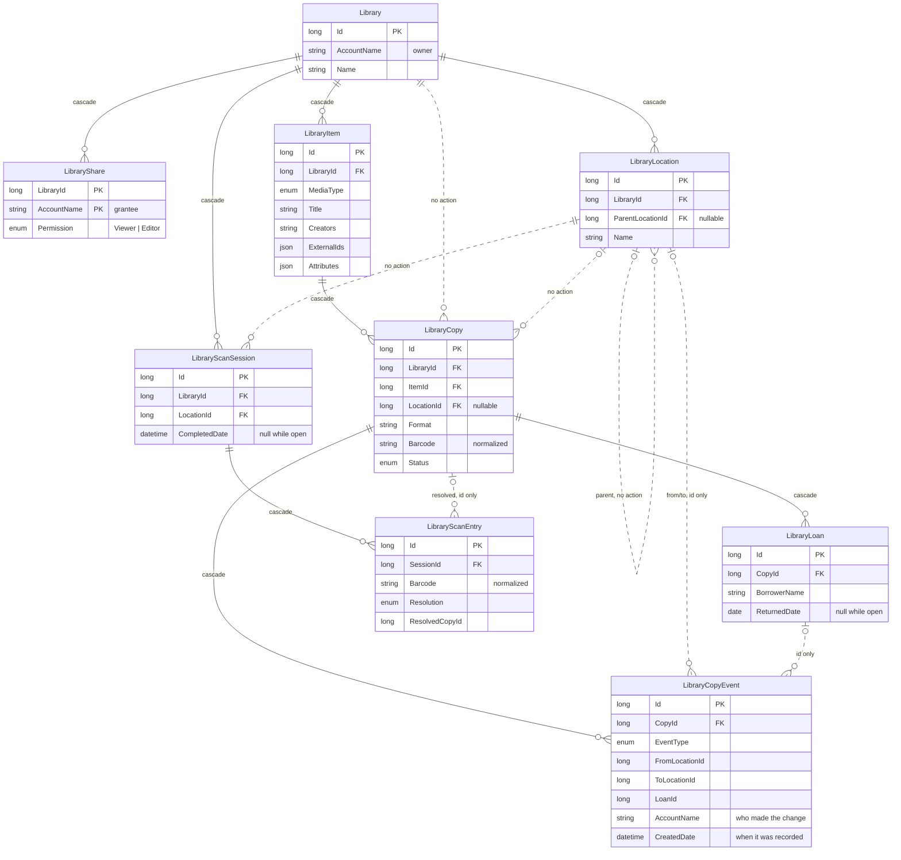
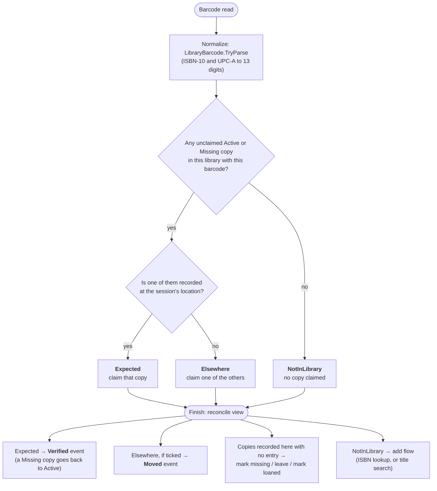

# Library

A personal inventory of physical media: books, movies and board games, plus anything else loanable. For each copy it
records where it lives, who borrowed it, the history of both, and acquisition details. A library can be shared with other
accounts as read-only or editable. The phone is the main tool, used two ways: checking "do I already own this?" while
shopping, and scanning barcodes to build the first inventory and later to reconcile one location at a time.

This is deliberately not a full library system. There are no holds, fines, patrons or cataloguing standards.

**Status.** The data model, migration and API exist (`src/Contracts/Libraries/`, `NsContext` `#region Library`,
`Migrations/*_AddLibrary*`), as do the Client, Tool and UI (`Pages/UI/Libraries/`), and so do three helpers the API is
built on: barcode normalization (`Utilities/LibraryBarcode.cs`), the access check (`DataAccess/LibraryAccess.cs`) and
event times (`Utilities/LibraryEventTimes.cs`). External lookup and covers exist too (`Services/Libraries/`). Scanning
and export described below are the plan for the remaining work, in the order listed under
[Delivery order](#delivery-order).

## Data model: item → copy

The Contracts classes are the EF entities, the same as Ledger. There are two levels, and that split is what handles
duplicates:

- **`LibraryItem`** is the work, e.g. *The Hobbit*. It holds the title, creators, series, summary, cover and external ids.
- **`LibraryCopy`** is one physical object. It holds format, barcode, edition details (publisher, year), location,
  condition, acquisition details and status.

A hardcover and a paperback are one item with two copies. Two identical paperbacks in different rooms are also one item
with two copies. The "do I own this?" answer reads naturally from that: *The Hobbit — 2 copies: Hardcover (Office ›
Shelf 3), Paperback (Kids' room)*.

**Rejected: work → edition → copy.** That is the "correct" bibliographic model (roughly FRBR), and it avoids repeating
edition details when you own two copies of the same edition. It was rejected because owning two identical copies is rare,
and repeating a publisher and year on two rows is cheap. A third level, on the other hand, puts an extra screen or choice
into every add and every scan. Edition details live on the copy. If a lookup returns edition-level data, such as a
cover that differs per edition, the item gets it from the first copy added.

**Recognizing an existing item.** Scanning an ISBN that isn't in the library yet doesn't automatically create a new
item. The ISBN lookup returns an Open Library work id, which is stored in `LibraryItem.ExternalIds`. If an item in the
library already shares any external id with the lookup, has a copy with the same barcode, or has exactly the same title
(ignoring case), the add flow offers "add as another copy of *X*". That is how a paperback joins the hardcover's item
instead of creating a duplicate. The keys in `LibraryExternalIds` are part of that match, so renaming one quietly stops
it finding items saved under the old name.

**Media types.** `LibraryMediaType` is an enum stored as a string (`NVARCHAR(32)`, the same way as `AccountTier`), so
adding a value needs no migration. Fields that only apply to some types (page count, runtime, player count, play time)
go in `LibraryItem.Attributes`, a string dictionary stored as a JSON column. That avoids a column per type-specific field
or a table per type. `Format` on the copy is a free string with suggested values per media type, not an enum. New
formats show up (Steelbook, 4K + Blu-ray combo), and none of them change any behaviour.

**Creators and tags** are single semicolon-separated strings, like `Account.Roles`, searched with `LIKE`. A creators
table would allow "everything by this author" with an exact match, but at personal-library volumes a `LIKE` on one
column is just as good and much less code.

**Barcodes are stored normalized** on both `LibraryCopy.Barcode` and `LibraryScanEntry.Barcode`, and every search
normalizes its input the same way. All of that goes through `LibraryBarcode.TryParse` (`Utilities/LibraryBarcode.cs`).
The same physical barcode reaches the server in several forms:
- A book scanned from its cover is an ISBN-13, but typed in from the copyright page it is often an ISBN-10.
- A movie's UPC-A comes back as 12 digits from one scanner and as a 13-digit EAN with a leading zero from another.

So every retail product code is brought to **GTIN-13**: ISBN-10 is converted to ISBN-13, and UPC-A gets the leading
zero. A path that skips this stores a form the others don't match, and lookups quietly miss.

- **Wrong check digit:** a code that has the length of an ISBN-10, UPC-A or EAN-13 but the wrong check digit is rejected
  (the API's 400), not stored. It is nearly always a typo or a misread, and a stored typo is a copy its real barcode
  never finds. The rare book with a misprinted ISBN can be added with no barcode.
- **8-digit codes are left as read.** UPC-E and EAN-8 are both 8 digits, and the digits alone don't say which was
  scanned. Expanding UPC-E to UPC-A would therefore mangle every EAN-8, and neither is common on books, movies or games.
- **Anything else** is kept, uppercased with spaces and dashes removed: a Code 128 or QR sticker you printed for a tool,
  say. This is what lets the "other loanable items" media type work with your own labels.

**History.** `LibraryCopyEvent` is append-only and written by the server whenever a copy's location, loan or status
changes. It also records which account made the change, because editors exist. `CreatedDate` is when the event was
recorded, and events are never edited after that.

**When a copy was acquired** comes from `LibraryCopy.AcquiredDate` (when set), not from its `Acquired` event's
`CreatedDate`. An initial inventory records a shelf of books bought over ten years all on the day it is scanned. The
real purchase dates often get filled in much later, by editing the copies. Because the acquisition time is read from
the copy, editing `AcquiredDate` moves the book's arrival in history and in the [gource export](#gource-export-planned)
without touching the event log.

**Rejected: an `EffectiveDate` on the event**, copied from `AcquiredDate` when the copy is created. It goes stale the
moment the purchase date is corrected, and keeping it current would mean editing an append-only table to keep a second
copy of a fact the copy already holds. That is the drift this repo avoids elsewhere.

The same rule covers loans, which already carry their real dates: a `Loaned` event's time is its loan's `LoanedDate`,
and a `Returned` event's is its `ReturnedDate`. Recording a loan that started last March puts it in March.

One helper computes event times for both the item page's history and the export. It walks a copy's events in recorded
order (`CreatedDate`, then `Id`):

- `Acquired` takes the copy's `AcquiredDate`, `Loaned` its loan's `LoanedDate`, and `Returned` its loan's
  `ReturnedDate`, each at midnight UTC and flagged as date-only. When that date isn't set, or for any other event type, the event takes its
  `CreatedDate`.
- Each time is then clamped up to at least the previous event's time.

The date-only flag is for display: a midnight-UTC time converted to local time shows as the previous day anywhere west
of UTC, so the item page shows a date-only event as a date. An event the clamp moves stops being date-only, since its
time then comes from another event.

The clamp keeps a copy's events in recorded order whatever dates are entered. A copy never moves or gets lent before it
arrives, and a loan backdated past a move that was recorded before it lands at the move instead of before it. The
[gource export](#gource-export-planned) depends on that order.

Loans have their own table (`LibraryLoan`), since they carry their own fields (due date, borrower). The event log
references a loan rather than duplicating it. A copy has at most one open loan, which the database enforces with a
filtered unique index, `IX_LibraryLoans_CopyId_Open` on `CopyId` where `ReturnedDate IS NULL`. The loan action checks
first, but two requests close together, such as a double tap on Lend, can both pass that check. A second open loan would
then break return, which expects exactly one, until it was fixed by hand. With the index, the second insert fails and
the action returns 409.

The ordinary `CopyId` index is declared explicitly beside it. Left implicit, EF adopts the filtered index as the foreign
key's index and drops the unfiltered one, leaving a copy's returned loans with no index.

**Loanees** are a free-text `BorrowerName`, optionally linked to an account via `BorrowerAccountName`. Most borrowers
are friends without accounts. The link exists so a borrower with an account could later see what they have out.

### Delete behaviour

In the diagram, solid lines cascade on delete. Dashed lines labelled `no action` are foreign keys that block the delete.
Dashed lines labelled `id only` are plain columns with no foreign key.

SQL Server refuses to create a schema where a table can be reached by two cascade paths. `LibraryCopy` has both
`LibraryId` and `ItemId`, and `LibraryItem` cascades from `Library`, so `Library → Copy` directly would be a second path.
The cascades are therefore:

- `Library → Item → Copy → Loan / Event`
- `Library → Location`, `Library → Share`, `Library → ScanSession → ScanEntry`

Every other foreign key into a copy or location (`Copy.LibraryId`, `Copy.LocationId`, `Location.ParentLocationId`,
`ScanSession.LocationId`) is `NoAction`.

Deleting a library therefore doesn't rely on one cascading delete of the library row. That would only work if SQL
Server checks the `NO ACTION` keys after the statement's cascades have run, which is plausible but has never been
tested here. The delete runs three bulk deletes in one transaction instead:
1. copies, which takes their loans and events with them;
2. scan sessions, which hold `NO ACTION` keys to locations;
3. the library, which cascades to items, locations and shares. Its locations' parent keys point only at other locations
   deleted in the same statement.

Deleting a location returns 409 while copies or child locations are still in it, so nothing silently loses its location.
Scan sessions at that location are deleted with it. They are a tool for reconciling a location, not history of the
copies, and keeping them would make any location that was ever scanned impossible to delete.

The location and loan ids on `LibraryCopyEvent` and the copy id on `LibraryScanEntry` are plain columns, not foreign keys,
so history survives the rows it mentions being deleted. The UI shows a deleted location as "(deleted location)" instead
of hiding the event.

### Naming

The namespace is `TcpWtf.NumberSequence.Contracts.Libraries`, not `.Library`, because the root entity is called
`Library`. A type with the same name as its namespace causes CS0118 in any file whose enclosing namespace makes `Library`
resolve to the namespace first. The Razor Pages folder has the same problem (`Pages/UI/Library` would make
`number_sequence.Pages.UI.Library` a namespace), so it should be `Pages/UI/Libraries`, with routes still under
`/ui/library`.

## Access and sharing

- `AccountRoles.Library` gates the whole feature. Everyone who uses a library needs it, including people it is shared
  with. `Account.Roles` was widened from 64 to 256 characters in the same migration, since adding `Library` brings the
  current set to 35.
- `LibraryShare(LibraryId, AccountName, Permission)` grants `Viewer` or `Editor`. `Owner` is never stored on a share: the
  owner is `Library.AccountName`. `LibraryPermission` is ordered (`Viewer < Editor < Owner`) so a check is a single
  comparison.
  - **Owner:** everything, plus managing shares and renaming or deleting the library.
  - **Editor:** add and change items, copies, locations, loans and scans.
  - **Viewer:** read only.
- `Library.CallerPermission` is `[NotMapped]`. The API fills it per request so the UI knows which controls to show.
- **Every library-scoped API action goes through `DataAccess/LibraryAccess.cs`.** `GetLibraryWithAccessAsync(libraryId,
  accountName, minimum)` loads the library with `CallerPermission` set. `GetAccessibleLibrariesAsync` lists every
  library an account can reach. `AccessibleLibraryIds` is a subquery for the cross-library barcode check. Nothing
  filters on `AccountName == User.Identity.Name` directly. That is the Ledger pattern, and copied here it would quietly
  lock out everyone a library is shared with. Ownership is compared in SQL rather than C#, so it uses the same
  case-insensitive collation as the account key.
- **No access is 404, too little access is 403.** An account with no access gets `NotFoundException`, so a library id
  doesn't reveal that the library exists. An account that can see the library but tries something above its level (a
  viewer editing) gets `ForbiddenException`, newly mapped to 403 in `ExceptionToStatusCodeMiddleware`. "Not found" would
  be wrong for a library that caller is looking at.
- The owner shares by account name, and the server checks the account exists. There is no invite flow.
- Tier limits: `TierLimits.LibrariesPerAccount` counts owned libraries only. `LibraryCopiesPerLibrary` uses the owner's
  tier (3,000 copies on Small).

## API

`LibraryController` (a partial class, one file per sub-resource like Ledger) is at `/library`, with
`RequiresToken(AccountRoles.Library)`. Everything is nested under `libraries/{libraryId}` except the routes that span
libraries:

- `barcodes/{barcode}` is the "do I own this?" check across **every library the caller can access**, so the shopping
  case doesn't start by choosing a library. It returns matching copies that aren't disposed, with their item and open
  loan. It only matches the exact barcode, so a different edition of something owned won't show up. The add page's
  duplicate check is what matches by Open Library work id.
- `lookup/isbn/{isbn}`, `lookup/search?mediaType=&q=`, `lookup/{source}/{sourceId}` and `lookup/cover?url=` call
  outside services and save nothing. See [External lookup](#external-lookup).

**Copies change location, status and loans only through dedicated actions** (`copies/{id}/move`, `/status`, `/loan`,
`/return`), because each one writes a `LibraryCopyEvent`. The general PUT of a copy leaves all three alone. It does
allow changing `ItemId` to another item in the same library: that is how a copy added as its own item gets merged into
the right one.

**Rules the actions enforce:**
- **Not recorded:** a move to where the copy already is, or a status it already has.
- **Disposed copies** can't be moved or lent; restore one first.
- **Copies on loan** can't be marked missing or disposed, because the borrower has them.
- **Dates:** a loan's due date can't precede its loan date, and a return date can't precede the loan date. Both
  dates default to today (UTC).
- **Copy limit:** `LibraryCopiesPerLibrary` uses the **owner's** tier, since an editor adds to someone else's library.
- **Leaving a library:** anyone can delete their own share, so a library can be left without the owner. Only the owner
  can delete anyone else's.
- **Account names** for shares and borrowers are checked to exist, and lowercased, because accounts are stored
  lowercase.

**A loan's id is drawn from its sequence before the insert.** The `Loaned` event's `LoanId` is a plain column with no
foreign key, so EF can't fill it in. Drawing the id first keeps the loan and its event in one save, which is atomic
without an explicit transaction. Explicit transactions are awkward here: the connection has retry-on-failure enabled,
which requires running them through the execution strategy. The only ones in the controller wrap bulk deletes
(`InBulkTransactionAsync`). Those bypass the change tracker, so a retry reruns them from the same state.

The draw is `Database.SqlQuery<long>(...)` read with `ToListAsync` and nothing composed on top. Composing anything,
even `SingleAsync`, makes EF wrap the sql as `SELECT TOP(n) ... FROM (...) AS s`. Sql server refuses `NEXT VALUE FOR`
inside a derived table and in any statement with `TOP`, so the composed form translates fine (`ToQueryString` shows
nothing wrong) and fails only when it runs.

Two alternatives were rejected:
- **A real foreign key from event to loan,** so EF could fix up the id itself. It would add a second cascade path from
  copy to event (copy → loan → event beside copy → event), which sql server forbids. Making that key no-action would
  put copy deletes back on the untested question of when no-action keys get checked.
- **`UseHiLo`,** which has EF draw ids client-side on `AddAsync`. It needs a model change and a migration that drops the
  column default, and it doesn't fit the way every other table here gets its id.

**Search** (`items?q=&mediaType=&locationId=&loanedOut=`):
- **Text:** `q` is matched with `LIKE` against title, subtitle, creators and series.
- **Barcodes:** if `q` parses as a barcode, a copy with that barcode also matches, so a scanned code can go in the
  same search box.
- **Locations:** `locationId` includes everything inside that location, so "Office" finds its shelves.
- **External ids:** `externalIdKey` with `externalIdValue` keeps items whose `ExternalIds` has that entry. The column
  is json, which EF sees only through the dictionary converter, so this one filter is sql (`JSON_VALUE`). The key
  becomes a json path, so it is limited to letters and digits.
- **Columns:** each item comes without its summary, external ids and attributes, which are null in the results even
  when set. Those are the large columns, and a page can hold 500 items. Copies come back whole, and each copy's `Loans`
  holds only its open loan. `items/{id}` has everything, including each copy's history with `OccurredDate` filled in by
  `LibraryEventTimes`.

**Responses are whole rows unless documented otherwise.** Narrow projections are fine inside the server, where the code
reading them knows what was selected. An entity returned from the API with fields left out looks exactly like one whose
fields are empty: a client can't tell a copy with no barcode from a copy whose barcode wasn't selected, and each new
column has to be remembered in every projection or it silently comes back null. So the API returns whole entities,
loaded with `Include`. Item search is the one exception, because its savings are real. Its doc comment and the bullet
above say which fields are missing. The first version of this controller hand-mapped partial entities in several
places, including loans; that was reverted for these reasons.

`Path` on `LibraryLocation` and `OccurredDate` on `LibraryCopyEvent` are `[NotMapped]` and computed per response, the
same way as `CallerPermission`. Clients resolve a copy's `LocationId` through the locations list, which carries the
paths; responses don't repeat location rows on every copy.

**Errors.** The access helper and barcode normalization report errors by throwing (`NotFoundException`,
`ForbiddenException`, `BadRequestException`), and `ExceptionToStatusCodeMiddleware` maps those to status codes. The
Library feature is the first code to throw them. Before, that middleware treated every exception as a crash: it
logged each at Error and returned the full stack trace as the body, which the UI would have shown on every 404. It now
returns just the message for the mapped exceptions and logs them at Information. Unmapped exceptions are still 500s
with the full trace.

## Client and Tool

The Client is `LibraryOperations` (partial, one file per sub-resource) exposed as `NsTcpWtfClient.Library`, one method
per API route. Deletes return nothing, because the API answers them with 204.

The Tool is `ns library` (alias `lib`). Libraries themselves are managed at the top level (`lib ls`, `lib create`), with
`share`, `location`, `item`, `copy` and `loan` beneath it, plus `owned <barcode>`. Each takes the usual CRUD aliases.
Choices that aren't obvious from `--help`:

- **`--library`/`-L` can be left out** when the caller can access exactly one library, which is the common case. With
  more than one, the command lists them and asks for the flag. Making every command take a library id argument
  would have meant typing the same number on every line.
- **Prompts take a blank answer as "keep the current value" and a lone `-` as "clear it".** The shared `Input` helpers
  can't leave a value empty or clear one that's set, and most library fields are optional. So the library commands
  carry their own small prompts (`LibraryCommand.Common.cs`) rather than changing the shared ones under every other
  command.
- **`item create` offers to add copies straight away**, since an item with no copies is rarely what was meant.
- **Location, status and loans have their own commands** (`copy move`, `copy status`, `copy loan`, `copy return`),
  matching the API, and `copy update` doesn't prompt for them. `copy update` does prompt for `ItemId`, which is how a
  duplicate gets merged.
- **`item read` shows the item, a table of copies and one combined history**, with event dates from the server's
  event-time helper. Moves show location paths and loans show the borrower. `--raw` gives the json instead.
- **Deleting a library, item or copy asks for confirmation** and points at disposing instead, which keeps history.
  Deleting a location doesn't ask, since the server refuses unless it's empty.

`lookup <isbn|title>` (`--type` for a title search, `--source` to get one record by id) writes the same columns
whatever was asked. `export <libraryId> [file]` waits for an export endpoint. The UI is the main way to manage a library, and the Tool is
for scripting: piping the export into gource, or diffing it against a spreadsheet. So `export` and `lookup` write
plain output with stable columns, to stdout unless a file is given, and print no prompts or other chatter.

## UI

Razor Pages under `Pages/UI/Libraries/`, routed at `/ui/library`, and built for a phone first: lists of cards rather
than tables, and copy actions as small forms that fold open in place. They call the API through `NsTcpWtfClient` like
Ledger, so the access rules are the API's and the pages only hide controls by `Library.CallerPermission`. The nav link
and home card show for the `Library` role.

- **Every action posts, then redirects back** with the outcome in a `[TempData]` message, so reload and the back button
  never resubmit. A form shown again in the same request, with what was typed, uses `FormError` instead: a `[TempData]`
  property set without a redirect is still saved, and the message shows a second time on the next page.
- **The home search covers every library you can see**, because "do I already own this?" shouldn't start by picking a
  library. It runs the item search once per library rather than adding a cross-library search endpoint, since an account
  sees a handful of libraries at most. A barcode with no match says so and offers "Add to *library*" with the barcode
  filled in.
- **Adding an item adds its first copy in the same form.** Before creating, the page looks for an item this might already
  be: one with a copy carrying the same barcode, or one with exactly the same title. If it finds one, it offers "Add copy
  here" on each match, which keeps everything typed for the copy, or "Create a new item anyway". The barcode is checked
  with `LibraryBarcode.TryParse` before anything is created, so a typo doesn't leave behind an item without its copy.
  "Add another after this" returns to the form with the type and location kept, for entering a shelf at a time.
- **Merging a duplicate** is "Belongs to another item?" on the copy's edit page: find the other item, and move the copy
  to it. That changes `LibraryCopy.ItemId`, and the copy's history goes with it. The item left with no copies is then
  deleted from its own page.
- **Edit pages apply the form onto the item or copy fetched from the server, then send that.** An update replaces every
  editable field, and the item form doesn't carry `ExternalIds` or `Attributes`. Sending the bound form would wipe them.
- **The acquired date starts blank, with a Today button.** Defaulting it to today would put every book in a first
  inventory into history as bought this week.
- **Confirmations read their text from `data-confirm`.** An inline `confirm('…')` breaks on a title with an apostrophe,
  because the attribute is decoded before the script runs.
- **Deleting a copy is only on its edit page**, so a misplaced tap on the item page can't do it. Status changes and
  "Disposed" are on the item page.

- **Lookup is all GET on the add page.** An ISBN (in the lookup box, or passed as `barcode` from the home page's "Not
  owned") fills the form in. A title lists candidates, and picking one comes back with `source` and `sourceId`. Each
  step carries the barcode, location and "add another" along, so a UPC typed in before a title search still lands on
  the copy. The lookup's external ids, attributes and cover urls aren't form fields, so they ride along as hidden
  inputs. The duplicate check runs as soon as the form is filled in, not only on submit, so "this might already be
  here" shows before anything is typed.
- **Adding a looked-up copy to an item typed in by hand** gives that item the lookup's external ids it lacks, so the
  next edition finds it by id rather than by title. Ids it already has are never changed.
- **Covers** show on cards (thumbnail) and the item page, and are set from the lookup when an item is created, or
  uploaded on the item's edit page. A phone photo is fine: the server turns it upright and resizes it. The `` tags
  point at the api route directly, which the token cookie authenticates, with the item's modified date in the query so
  the api can cache covers for a month. The api streams each cover from blob storage to the response rather than
  reading it into memory first, since a page of cards asks for dozens at once.
- **Credits:** pages showing looked-up data name the source (`_LookupAttribution`), as TMDB's terms require.

The Scan button waits for scanning.

## Gource export (planned)

[Gource](https://gource.io) animates a version-control history as a growing tree. Its
[custom log format](https://github.com/acaudwell/Gource/wiki/Custom-Log-Format) is one line per change,
`timestamp|user|A/M/D|path|colour`, which makes it an easy way to watch a library fill up and move around over the
years. The export is `GET library/libraries/{id}/events/gource` (text/plain), with `library export-gource <libraryId>
<file.log>` in the Tool, then `gource file.log`.

Mapping:

- **Path:** `/{location path}/{title} ({format}) #{copyId}`, so locations are the directories and each copy is a file.
  The copy id keeps two identical paperbacks from collapsing into one file. `|` and `/` in names are replaced, since
  they are the format's field and path separators. A copy with no location sits under `/(no location)/`, a loaned
  copy under `/(on loan)/{borrower}/`, and a missing copy under `/(missing)/`.
- **Colour:** one per `MediaType`, rather than gource's default of colouring by file extension, which here would mean
  nothing.
- **User:** the event's `AccountName`, so an editor's activity shows up as a second person working on the tree.
- **Events:** `Acquired` and `Restored` → `A`. `Verified` → `M` (a pulse on the file). `Disposed` → `D`. Gource
  has no rename, so `Moved`, `Loaned`, `Returned` and `MarkedMissing` each become a `D` at the old path followed by an
  `A` at the new one, both with the same timestamp.
- **Time:** the event time from the shared helper (see [History](#data-model-item--copy)) as unix seconds, sorted
  ascending with `Id` to break ties, because gource requires the log to be in order. The sort must be stable: clamping
  can give several of a copy's events the same time, and they still have to come out in recorded order.

Because the helper's clamp keeps each copy's events in recorded order, the `D` half of each move can use the event's
stored `FromLocationId`, and it names a file gource has already seen. A `D` for a path gource has never seen leaves an
orphaned file in the tree. That is why the clamp exists, and why a date on a copy or loan can never reorder that copy's
events.

Paths use location names as they are now, since locations don't keep a name history. A renamed shelf shows under its
new name for its whole history. A deleted location shows as `(deleted location #id)`.

## External lookup

`Services/Libraries/`. `LibraryLookup` picks the provider for a request and caches answers; one class per provider does
the calls. A lookup returns a `LibraryLookupResult`: item fields, edition fields for the first copy (barcode, format,
publisher, year), external ids, attributes and cover urls. It saves nothing. A search returns candidates that may lack
fields (TMDB's search has no director), and the chosen one is fetched again by `Source` and `SourceId` for the full
record.

- **Books by ISBN:** Open Library first, then Google Books when Open Library has no record or is down.
  - Open Library spreads a book over three records: the edition (publisher, format, pages, cover), the work (summary)
    and the search index, which already has the author names resolved. Using the index saves a request per author.
    Its record is only used when its work id matches, because a search that misread the query would return another
    book's authors without anyone noticing. When it doesn't match, each author's record is fetched instead.
  - The edition's cover is preferred over the work's, which may show another edition.
  - Open Library's free-text physical format is mapped onto the suggested formats; anything else is left blank rather
    than stored as one cataloguer typed it.
  - Google Books only knows the edition, so `Year` (first release) is left empty rather than set to a reprint's year.
- **Books by title:** Open Library's search, which is also how a book with no ISBN gets details.
- **Movies by title:** TMDB `search/multi` (movies and TV in one request), then `movie/{id}?append_to_response=credits`
  or `tv/{id}`. A UPC doesn't identify a movie in TMDB, so a scanned UPC is saved on the copy (a rescan finds it) and
  the details come from a title search. A movie's TMDB collection becomes its series.
- **Board games by title:** BoardGameGeek XML API2. Its search returns every game with a matching name, in no useful
  order, with names and years only; "Catan" matches hundreds. So names are ranked (exact, prefix, shortest), the best 20
  are fetched in one `thing` request (BGG's limit), and those are ordered by how many people rated them, which puts the
  game most people mean first. An expansion's base game becomes its series.

**Rejected:**
- **UPC databases** (e.g. UPCitemdb's free tier). Their results for movies and games are thin and inconsistent, and
  the free tiers are rate limited to around 100 a day, which a first inventory run blows through.
- **A Google Books key.** It would be one more secret in Key Vault, the variable group, the template and `devinit.ps1`,
  for a fallback that rarely runs. Keyless use is allowed at low volume. Add one if its quota starts refusing.
- **An `ILibraryLookupProvider` interface.** The providers don't share a shape (ISBN for books only, search plus fetch
  for the rest), so the interface would have been mostly unsupported methods.

**Caching:** answers are cached in `IMemoryCache` for an hour, misses included, since one add asks about the same record
several times (search, pick, the form shown again). Failures aren't cached.

**Failures** become `FailedDependencyException`, which the middleware maps to **424**, with a message naming the
provider. Not a 5xx: the client retries those five times over about half a minute, which would turn one slow provider
into a page that hangs. The add page shows the message and carries on with typing details in.

**Provider values aren't trusted in urls.** Only the cover client has a host allowlist, so anything taken from a response
is checked before it goes into a request or a link. Open Library's keys carry their leading slash (`/works/OL45883W`) and
are appended straight after the host, where a key like `@other.host/x` would send the request to another host. So each
key must match its kind's shape (`/works/OL…W`, `/books/OL…M`, `/authors/OL…A`) or is ignored. BoardGameGeek's ids
must be digits, since they go into a query unescaped. A source link that isn't http or https is dropped, because the
add page puts it in an `href`.

**Tokens:** `Options.LibraryLookup` (`TmdbToken`, `BggToken`). A blank token turns that provider off, and searching that
media type is a 400 saying so. They come from Key Vault (`library-lookup-tmdb-token`, `library-lookup-bgg-token`)
through the `tompostler` variable group into `deploy-code.yml` and `AppServiceSettings.json`, and through
`devinit.ps1`, which leaves a missing one unset rather than failing. Azure Pipelines passes `$(name)` through literally
when the group has no such secret, so a token starting `$(` also counts as unset. That lets the app deploy before a
token is registered.

**Credits:** TMDB's terms require the line "This product uses the TMDB API but is not endorsed or certified by TMDB"
on pages showing its data, and BoardGameGeek asks for credit too. `_LookupAttribution` shows a line per source, on the
add page and on the item page, judged by the item's external ids. TMDB also asks for its logo; there is no `wwwroot` to
serve one from, so for now it's the text line only.

### Covers

Stored in blob storage (container `library`: `covers/{itemId}.webp` and `covers/thumbnails/{itemId}.webp`), not as
SQL bytes like the Ledger logos, because a few thousand covers don't belong in the database. They are never hotlinked:
provider URLs change, and hotlinking leaks browsing to third parties. The extension is only so a cover downloaded by
hand from the storage account opens; the app serves the content type from `LibraryCovers`. It does tie the path to the
format, so changing the format means renaming or re-encoding the existing covers along with it.

- **Every cover is re-encoded** by `LibraryCovers` with SkiaSharp (already in the app for ScottPlot): turned upright from
  its EXIF orientation, which phone photos depend on, scaled to fit 900px and 240px, and saved as WebP on white. That
  keeps lists light (a 240px thumbnail is a few KB) and makes serving them safe: what's stored is an image this code
  drew, so nothing uploaded or fetched is ever served from this site as-is. That includes the add page's preview of a
  lookup cover (`lookup/cover`), which is re-encoded the same way.
- **WebP at quality 90.** WebP is a quarter to a third smaller than JPEG at the same quality, and every current browser
  shows it. PNG was rejected: covers are photos and artwork, which lossless compression makes several times larger for
  no visible gain. Quality is 90 rather than the usual 75–80 so a stored cover is still a good source if covers are ever
  re-encoded (a new size, say) without going back to the providers. The flattening onto white is deliberate even though
  WebP keeps transparency: a transparent cover with dark artwork disappears against the dark theme.
- **Fetching is only from provider hosts**, checked again on every redirect, because the urls come from the request.
  The cover HttpClient follows no redirects itself; `LibraryCovers` follows up to three, checking each host. Open
  Library's cover urls redirect to archive.org, which is why it's on the list. Without the check, the cover endpoint
  would fetch any url for anyone with the Library role, including addresses inside the app service.
- **Limits:** 15 MB in and 50 megapixels, since a small file can claim enormous dimensions and decoding allocates for all
  of them.
- **Deletes:** deleting an item or a library deletes its cover blobs after the rows are gone, so a failure leaves an
  unreferenced blob (logged) rather than an item pointing at a missing cover.
- **The container** is in `storageAccountContainerNames` in `build/jobs/deploy-prereqs.yml` for both prod and LocalDev.
  The app doesn't create it, so the prereqs pipeline has to run before covers work in either.
- **LocalDev mirrors prod's covers** when `devinit.ps1` replaces `nslocal` from prod: it copies prod's `library`
  container into the local one server side. A database copy alone leaves every prod item with `HasCover` set and no
  blob, so every cover is a broken image locally. Every blob is overwritten rather than skipped when it exists: a
  replaced cover keeps its name, and once the copies diverge, a local-only item can get the same id as a later prod one,
  so skipping by name (or by newer timestamp, as azcopy's sync does) can keep the wrong image. Local-only blobs are left
  in place, since nothing shows a cover its item isn't flagged for. The `pdf` container isn't copied: those are patient
  documents, and nothing local needs them.

## Scanning and reconciling (planned)

The same flow handles first-time inventory and later reconciling:

1. Pick a location. This starts a `LibraryScanSession`.
2. Scan continuously. Each barcode becomes a `LibraryScanEntry`, stored on the server as it is scanned, so a phone that
   locks or reloads mid-shelf loses nothing. Keeping the state in browser memory was rejected for exactly that reason.
3. Each entry is resolved when scanned: `Expected` (a copy with this barcode is recorded here), `Elsewhere` (recorded at
   another location or none), or `NotInLibrary`.
4. **Finish** shows the reconcile view:
   - verified;
   - to move here;
   - expected here but not scanned (mark missing, leave as is, or mark loaned);
   - new barcodes (ISBNs can be added in bulk through lookup; others are added one at a time by title).
5. Applying the reconcile writes the events and sets `CompletedDate`.

For a first inventory nothing is expected anywhere yet, so every entry is `NotInLibrary` and the reconcile becomes "add
everything".

**Duplicates while scanning.** Each scan matches at most one copy, and an earlier scan in the same session claims its
copy first. "Unclaimed" means not already the `ResolvedCopyId` of an earlier entry in the session. When several copies
share the barcode, a copy recorded at this location is claimed before one recorded elsewhere, so scanning a shelf never
reports a move for a copy that was already there. Two copies of the same paperback therefore need two scans. A third
scan of that barcode resolves to `NotInLibrary`, which is correct: it's a copy you didn't know you had. An accidental
double scan is fixed by removing the entry.

`Missing` copies are matched along with `Active` ones, because scanning a missing copy is how it gets found. `Disposed`
copies are not matched. A disposed copy that turns up again is restored deliberately from its item page, not by a scan.

**Camera.** There is no `wwwroot`, so the scanner is loaded from jsDelivr like Bootstrap. It is the `barcode-detector`
ponyfill (zxing-wasm), which uses the browser's native `BarcodeDetector` where there is one (Android Chrome) and WASM
elsewhere. iOS Safari has no native `BarcodeDetector`, which rules out using the native API alone. The scanner reads
EAN-13, UPC-A and UPC-E and debounces repeat reads of the same code. A text box is always there as well, and a USB or
Bluetooth handheld scanner works through it as a keyboard. The scan page calls the `/library/...` API directly with
`fetch`, using the `ns-token` cookie `RequiresTokenFilter` already accepts. That avoids page handlers and antiforgery
tokens for what is the only JS-heavy page.

## Delivery order

1. **Core:** the data model, the three helpers, the API, Client and Tool CRUD, and UI for browse, search, detail,
   manual add/edit, loans, locations and shares (done).
2. **Lookup:** the providers, covers in blob, and options and deployment settings (done).
3. **Scanning:** the camera scanner, scan sessions and the reconcile view.
